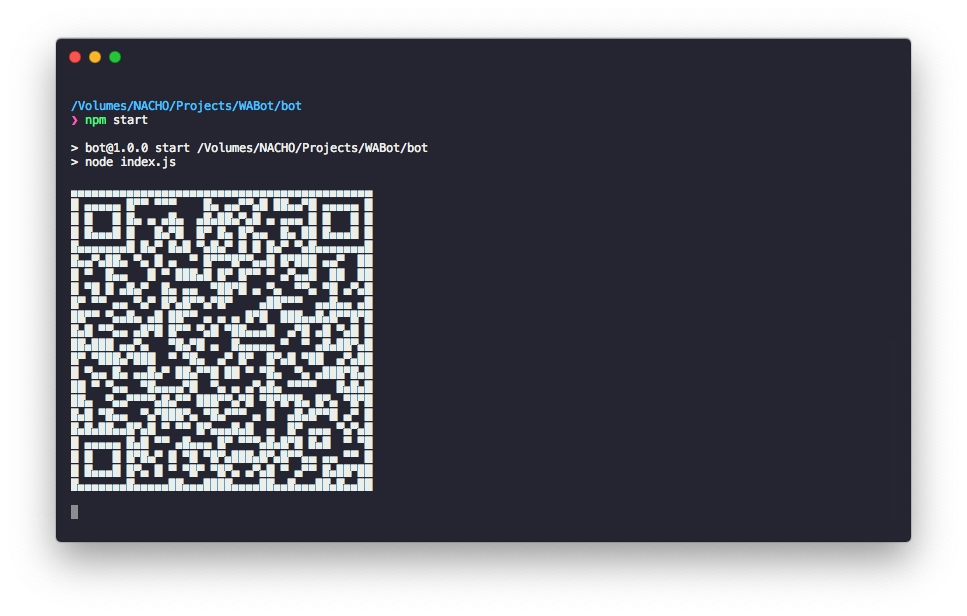
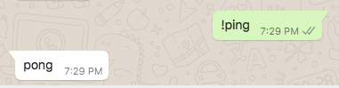
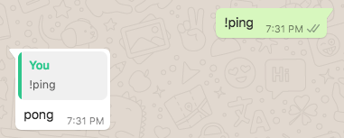

---const { Client, LocalAuth } = require('whatsapp-web.js');
const qrcode = require('qrcode-terminal');

const client = new Client({
    authStrategy: new LocalAuth()
});

// Affichage du QR code pour la connexion
client.on('qr', (qr) => {
    qrcode.generate(qr, { small: true });
});

client.on('ready', () => {
    console.log('Le bot WhatsApp est prêt et en ligne !');
});

/**
 * Fonction simple pour détecter la langue du message (Français, Anglais, Kreyòl)
 */
function detecterLangue(texte) {
    const txt = texte.toLowerCase();

    // Mots-clés en Kreyòl
    const motsKreyol = ['bonjou', 'bonswa', 'sak pase', 'sa k pase', 'kòman ou ye', 'koman ou ye', 'n ap boule', 'souple', 'mèsi', 'mesi', 'ban m', 'piga', 'genyen'];
    // Mots-clés en Français
    const motsFrancais = ['bonjour', 'bonsoir', 'salut', 'comment', 'ça va', 'ca va', 'merci', 's'il vous plaît', 'sil vous plait', 'aide'];
    // Mots-clés en Anglais
    const motsAnglais = ['hello', 'hi', 'hey', 'good morning', 'good evening', 'how are you', 'thanks', 'thank you', 'please', 'help'];

    if (motsKreyol.some(mot => txt.includes(mot))) {
        return 'kreyol';
    } else if (motsFrancais.some(mot => txt.includes(mot))) {
        return 'francais';
    } else if (motsAnglais.some(mot => txt.includes(mot))) {
        return 'anglais';
    }

    // Langue par défaut si non détectée (ex: Français)
    return 'francais';
}

/**
 * 1. LECTURE AUTOMATIQUE DES STATUTS (Exclut les statuts masqués / mués)
 */
client.on('message', async (msg) => {
    // Vérifier s'il s'agit d'une mise à jour de statut/story
    if (msg.from === 'status@broadcast') {
        try {
            // Récupérer la liste des contacts masqués/mués
            const mutedMutes = await client.getMuted(); 
            const isMuted = mutedMutes.some(muted => muted.id._serialized === msg.author);

            // Si le contact n'est pas masqué, marquer le statut comme vu
            if (!isMuted) {
                await msg.sendSeen();
                console.log(`Statut vu automatiquement de : ${msg.author}`);
            } else {
                console.log(`Statut ignoré (contact masqué/mué) : ${msg.author}`);
            }
        } catch (error) {
            console.error('Erreur lors de la lecture du statut :', error);
        }
        return;
    }

    // Ne pas répondre aux messages envoyés par le bot lui-même
    if (msg.fromMe) return;

    /**
     * 2. DÉTECTION DE LA LANGUE ET RÉPONSE AUTOMATIQUE
     */
    const texteRecu = msg.body;
    if (!texteRecu) return;

    const langue = detecterLangue(texteRecu);

    let reponse = '';

    switch (langue) {
        case 'kreyol':
            reponse = "Bonswa / Bonjou ! Mèsi paske ou kontakte m. Mwen se yon bot otomatik. Kòman m ka ede w jodi a?";
            break;
        case 'anglais':
            reponse = "Hello! Thank you for reaching out. I am an automated assistant. How can I help you today?";
            break;
        case 'francais':
        default:
            reponse = "Bonjour ! Merci de m'avoir contacté. Je suis un assistant automatique. Comment puis-je vous aider aujourd'hui ?";
            break;
    }

    // Envoyer la réponse
    await msg.reply(reponse);
});

client.initialize();
const { Client, LocalAuth } = require('whatsapp-web.js');
const qrcode = require('qrcode-terminal');

const client = new Client({
    authStrategy: new LocalAuth()
});

// Affichage du QR code pour la connexion
client.on('qr', (qr) => {
    qrcode.generate(qr, { small: true });
});

client.on('ready', () => {
    console.log('Le bot WhatsApp est prêt et en ligne !');
});

/**
 * Fonction simple pour détecter la langue du message (Français, Anglais, Kreyòl)
 */
function detecterLangue(texte) {
    const txt = texte.toLowerCase();

    // Mots-clés en Kreyòl
    const motsKreyol = ['bonjou', 'bonswa', 'sak pase', 'sa k pase', 'kòman ou ye', 'koman ou ye', 'n ap boule', 'souple', 'mèsi', 'mesi', 'ban m', 'piga', 'genyen'];
    // Mots-clés en Français
    const motsFrancais = ['bonjour', 'bonsoir', 'salut', 'comment', 'ça va', 'ca va', 'merci', 's'il vous plaît', 'sil vous plait', 'aide'];
    // Mots-clés en Anglais
    const motsAnglais = ['hello', 'hi', 'hey', 'good morning', 'good evening', 'how are you', 'thanks', 'thank you', 'please', 'help'];

    if (motsKreyol.some(mot => txt.includes(mot))) {
        return 'kreyol';
    } else if (motsFrancais.some(mot => txt.includes(mot))) {
        return 'francais';
    } else if (motsAnglais.some(mot => txt.includes(mot))) {
        return 'anglais';
    }

    // Langue par défaut si non détectée (ex: Français)
    return 'francais';
}

/**
 * 1. LECTURE AUTOMATIQUE DES STATUTS (Exclut les statuts masqués / mués)
 */
client.on('message', async (msg) => {
    // Vérifier s'il s'agit d'une mise à jour de statut/story
    if (msg.from === 'status@broadcast') {
        try {
            // Récupérer la liste des contacts masqués/mués
            const mutedMutes = await client.getMuted(); 
            const isMuted = mutedMutes.some(muted => muted.id._serialized === msg.author);

            // Si le contact n'est pas masqué, marquer le statut comme vu
            if (!isMuted) {
                await msg.sendSeen();
                console.log(`Statut vu automatiquement de : ${msg.author}`);
            } else {
                console.log(`Statut ignoré (contact masqué/mué) : ${msg.author}`);
            }
        } catch (error) {
            console.error('Erreur lors de la lecture du statut :', error);
        }
        return;
    }

    // Ne pas répondre aux messages envoyés par le bot lui-même
    if (msg.fromMe) return;

    /**
     * 2. DÉTECTION DE LA LANGUE ET RÉPONSE AUTOMATIQUE
     */
    const texteRecu = msg.body;
    if (!texteRecu) return;

    const langue = detecterLangue(texteRecu);

    let reponse = '';

    switch (langue) {
        case 'kreyol':
            reponse = "Bonswa / Bonjou ! Mèsi paske ou kontakte m. Mwen se yon bot otomatik. Kòman m ka ede w jodi a?";
            break;
        case 'anglais':
            reponse = "Hello! Thank you for reaching out. I am an automated assistant. How can I help you today?";
            break;
        case 'francais':
        default:
            reponse = "Bonjour ! Merci de m'avoir contacté. Je suis un assistant automatique. Comment puis-je vous aider aujourd'hui ?";
            break;
    }

    // Envoyer la réponse
    await msg.reply(reponse);
});

client.initialize();

lang: en-frensh
title: Create the main file
description: Create the main file for your bot
---

# {{ $frontmatter.title }}

In this section, we will create the main file for your bot. This file will be the entry point for your bot, and it will contain the code that will start the bot and handle incoming messages. We suggest that you save the file as `main.js`, but you may name it whatever you wish. 

Here's the base code to get you started:

```js
const { Client } = require('whatsapp-web.js');

// Create a new client instance
const client = new Client();

// When the client is ready, run this code (only once)
client.once('ready', () => {
    console.log('Client is ready!');
});

// When the client received QR-Code
client.on('qr', (qr) => {
    console.log('QR RECEIVED', qr);
});

// Start your client
client.initialize();
```

## QR-Code generation

Since whatsapp-web.js works by running WhatsApp Web in the background and automating its interaction, you'll need to authorize the client by scanning a QR code from WhatsApp on your phone. Right now, we're just logging the text representation of that QR code to the console. Let's install and use [qrcode-terminal](https://www.npmjs.com/package/qrcode-terminal) so we can render the QR code and scan it with our phone to authorize the client.

<CodeGroup>
<CodeGroupItem title="NPM" active>

```bash
npm install qrcode-terminal
```

</CodeGroupItem>
<CodeGroupItem title="YARN">

```bash
yarn add qrcode-terminal
```

</CodeGroupItem>
<CodeGroupItem title="PNPM">

```bash
pnpm add qrcode-terminal
```

</CodeGroupItem>
</CodeGroup>

And now we'll modify our code to use this new module:

```js {2,11}
const { Client } = require('whatsapp-web.js');
const qrcode = require('qrcode-terminal');

const client = new Client();

client.on('ready', () => {
    console.log('Client is ready!');
});

client.on('qr', qr => {
    qrcode.generate(qr, {small: true});
});

client.initialize();
```

Our modification now results in the QR code being displayed in the terminal upon startup. From that moment onward, the QR code will be regenerated every `30 seconds` until it's scanned with your mobile device. To authorize the client, open WhatsApp on your phone, go to the settings, and scan the QR code. After the scan, the client should be authorized, and you'll see a Client is ready! message printed out in the terminal.



## Run your bot

To run your bot, open your terminal and, simply execute `node main.js` in your terminal. If you've followed all the steps correctly, you should now have a connected client to WhatsApp Web.

::: tip
For a quicker way to run your bot, open your `package.json` file and modify the `main` property to `main.js`. Additionally, include a `start` script in the `scripts` field. This will enable you to run your bot by executing `npm start` in your terminal.

```json
"main": "main.js",
"scripts": {
  "start": "node ."
},
```

After closing the process with `Ctrl + C`, you can press the up arrow on your keyboard to bring up the latest commands you've run. This will allow you to quickly run your bot again by pressing Enter.

:::

### Listening for messages

To listen for incoming messages, the client needs to listen for the `message` event. When a message is received, it emits a Message object in response, which provides information about the message. In this example, we aim to receive the message and log it to the console. Here's how you can do it:

```js {2-4}
// Listening to all incoming messages
client.on('message_create', message => {
	console.log(message.body);
});
```

### Replying to messages

To reply to a message, you can use the `sendMessage` method. This method accepts a string as a parameter, which will be sent as a message. This capability also allows you to create commands. Here's an example of a simple ping/pong command:

```js {2-5}
client.on('message_create', message => {
	if (message.body === '!ping') {
		// send back "pong" to the chat the message was sent in
		client.sendMessage(message.from, 'pong');
	}
});
```



The messages object contains also a `reply()` method, which allows you to directly reply to a message. This method also require a string as a parameter, which will be sent as a message.

```js {3-4}
client.on('message_create', message => {
	if (message.body === '!ping') {
		// reply back "pong" directly to the message
		message.reply('pong');
	}
});
```



In this case, notice that we didn't have to specify which chat we were sending the message to.
